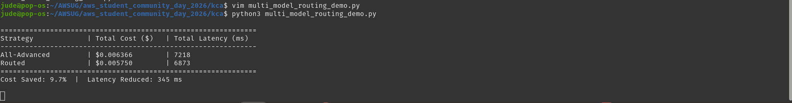
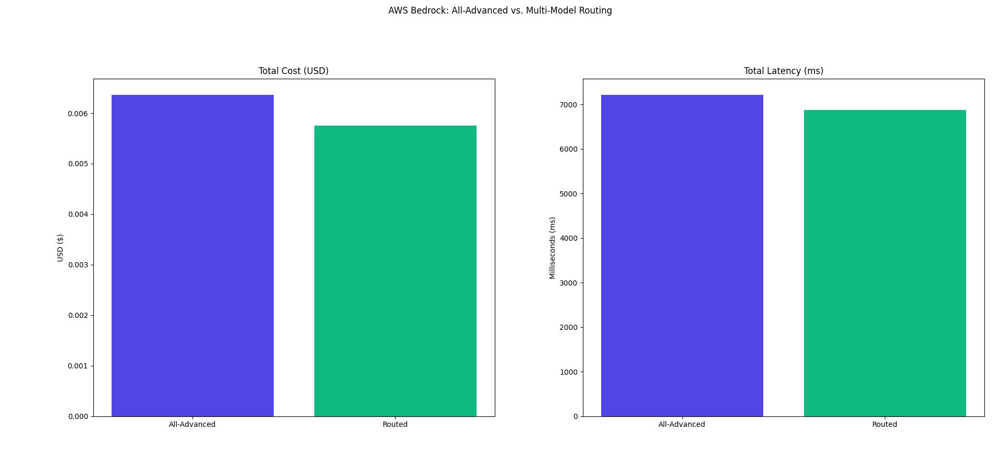

# AWS Bedrock Multi-Model Routing — Hands-On Demo Guide

**Workshop 4 · AWS Student Community Day @ KCA University**  

This guide walks you step-by-step through setting up IAM permissions from your terminal, running a **manual complexity-based multi-model router** with `boto3` ,complete with cost and latency graphs.

---

## Prerequisites

Before starting, make sure you have:
1. **Python 3.9+** installed (`python3 --version` or `python --version`)
2. **AWS CLI v2** installed (`aws --version`)
3. **An AWS Account** with existing CLI credentials (or access to create an IAM user)

> **First-Time Anthropic User Note:** Amazon Nova models work immediately, but if your AWS account has never invoked an Anthropic Claude model before, you may need to submit Anthropic's quick one-time use-case form in the **Amazon Bedrock Console → Model catalog** before your first API call succeeds.

---

## Step 1: Create a Scoped IAM User for Bedrock (Terminal)

> **Shortcut:** If your AWS CLI is *already* configured with a non-root IAM user or role that has `AdministratorAccess` or `AmazonBedrockLimitedAccess`, you can **skip directly to Step 2**.

Run the following commands using an existing admin CLI profile to create a dedicated, least-privilege user for this workshop.

### Linux / macOS (Bash / Zsh)
```bash
# 1. Create the IAM user
aws iam create-user --user-name bedrock-demo-user

# 2. Attach the AWS-managed Bedrock policy (includes InvokeModel & Marketplace auto-subscribe)
aws iam attach-user-policy \
    --user-name bedrock-demo-user \
    --policy-arn arn:aws:iam::aws:policy/AmazonBedrockLimitedAccess

# 3. Generate access keys (save the AccessKeyId and SecretAccessKey from the output)
aws iam create-access-key --user-name bedrock-demo-user
```

### Windows (PowerShell)
```powershell
# 1. Create the IAM user
aws iam create-user --user-name bedrock-demo-user

# 2. Attach the AWS-managed Bedrock policy
aws iam attach-user-policy `
    --user-name bedrock-demo-user `
    --policy-arn arn:aws:iam::aws:policy/AmazonBedrockLimitedAccess

# 3. Generate access keys (save the AccessKeyId and SecretAccessKey from the output)
aws iam create-access-key --user-name bedrock-demo-user
```

---

## Step 2: Configure & Verify AWS CLI Credentials

Configure your local terminal to use your credentials (works identically on Linux, macOS, and Windows):

```bash
aws configure
```

When prompted, enter:
* **AWS Access Key ID:** `<paste your AccessKeyId>`
* **AWS Secret Access Key:** `<paste your SecretAccessKey>`
* **Default region name:** `us-east-1`
* **Default output format:** `json`

Verify your active identity:
```bash
aws sts get-caller-identity
```

---

## Step 3: Set Up Your Python Environment

Create a project folder, set up a virtual environment, and install `boto3` and `matplotlib`.

### Linux / macOS (Bash / Zsh)
```bash
mkdir bedrock-routing-demo && cd bedrock-routing-demo
python3 -m venv venv
source venv/bin/activate
pip install boto3 matplotlib
```

### Windows (PowerShell)
```powershell
mkdir bedrock-routing-demo
cd bedrock-routing-demo
python -m venv venv
.\venv\Scripts\Activate.ps1
pip install boto3 matplotlib
```

> **Windows Tip:** If PowerShell blocks `Activate.ps1` with an execution policy error, run:
> ```powershell
> Set-ExecutionPolicy -ExecutionPolicy RemoteSigned -Scope CurrentUser
> ```
> Then re-run `.\venv\Scripts\Activate.ps1`.

---

## Step 4: Create & Run the Manual Routing Demo

Create a file named `routing_demo.py` inside your `bedrock-routing-demo` folder and paste the code in `multi_model_routing_demo.py`

This script:
1. Sends both a **simple prompt** and a **complex prompt** to **Claude Sonnet 4.5**.
2. Runs the exact same two prompts through a **complexity router** (routing the simple prompt to **Amazon Nova Lite** and the complex one to **Claude Sonnet 4.5**).
3. Prints a **terminal comparison table** and pops up a **side-by-side cost & latency bar chart**.


### Run the Script

**Linux / macOS:**
```bash
python3 routing_demo.py
```

**Windows (PowerShell):**
```powershell
python routing_demo.py
```

---

## Sample Demo Output

Below is a live run of `multi_model_routing_demo.py` comparing **All-Advanced** (sending both prompts to Claude Sonnet) against **Routed** (sending the simple cloud computing prompt to Amazon Nova Lite and the Vaswani et al. attention-heads prompt to Claude Sonnet):

### 1. Terminal Comparison Table



* **All-Advanced:** `$0.006366` total cost | `7218 ms` total latency
* **Routed:** `$0.005750` total cost | `6873 ms` total latency
* **Result:** **9.7% cost saved** and **345 ms latency reduced** on just a 2-prompt 50/50 split—savings scale dramatically when 70%+ of production traffic consists of routine queries.

### 2. Cost & Latency Visualization



---

## Step 5: Amazon Bedrock Intelligent Prompt Routing (CLI Syntax Walkthrough)

Manual `if/else` keyword rules are great for learning, but they get brittle in production. Amazon Bedrock provides **Intelligent Prompt Routing** so AWS predicts response quality and routes automatically within a model family.


### 1. Create a Custom Prompt Router

**Linux / macOS (Bash / Zsh):**
```bash
aws bedrock create-prompt-router \
    --prompt-router-name kca-workshop-router \
    --models '[{"modelArn": "arn:aws:bedrock:us-east-1::foundation-model/anthropic.claude-sonnet-4-5-20250929-v1:0"}]' \
    --fallback-model '{"modelArn": "arn:aws:bedrock:us-east-1::foundation-model/anthropic.claude-haiku-4-5-20251001-v1:0"}' \
    --routing-criteria '{"responseQualityDifference": 0.5}'
```

**Windows (PowerShell):**
```powershell
aws bedrock create-prompt-router `
    --prompt-router-name kca-workshop-router `
    --models '[{"modelArn": "arn:aws:bedrock:us-east-1::foundation-model/anthropic.claude-sonnet-4-5-20250929-v1:0"}]' `
    --fallback-model '{"modelArn": "arn:aws:bedrock:us-east-1::foundation-model/anthropic.claude-haiku-4-5-20251001-v1:0"}' `
    --routing-criteria '{"responseQualityDifference": 0.5}'
```

### 2. Invoke the Router via Converse API
Pass the Prompt Router ARN as your `--model-id`. The response metadata will include `trace.promptRouter.invokedModelId` showing which model handled the request.

**Linux / macOS (Bash / Zsh):**
```bash
aws bedrock-runtime converse \
    --model-id "arn:aws:bedrock:us-east-1:<account-id>:prompt-router/kca-workshop-router" \
    --messages '[{"role": "user", "content": [{"text": "What are attention heads according to Vaswani et al.?"}]}]'
```

**Windows (PowerShell):**
```powershell
aws bedrock-runtime converse `
    --model-id "arn:aws:bedrock:us-east-1:<account-id>:prompt-router/kca-workshop-router" `
    --messages '[{"role": "user", "content": [{"text": "What are attention heads according to Vaswani et al.?"}]}]'
```

### 3. Manage Your Prompt Routers
Additional lifecycle commands available in the Bedrock API & CLI:
* **Inspect a router:** `aws bedrock get-prompt-router --prompt-router-arn <router-arn>`
* **List all routers:** `aws bedrock list-prompt-routers`
* **Delete a router:** `aws bedrock delete-prompt-router --prompt-router-arn <router-arn>`

---

## Step 6: Clean Up

If you created `bedrock-demo-user` in Step 1, remove the access key and IAM user once you are done so no unused credentials remain in your AWS account.

### Linux / macOS (Bash / Zsh)
```bash
# Replace <YOUR_ACCESS_KEY_ID> with the key created in Step 1
aws iam delete-access-key \
    --user-name bedrock-demo-user \
    --access-key-id <YOUR_ACCESS_KEY_ID>

aws iam detach-user-policy \
    --user-name bedrock-demo-user \
    --policy-arn arn:aws:iam::aws:policy/AmazonBedrockLimitedAccess

aws iam delete-user --user-name bedrock-demo-user
```

### Windows (PowerShell)
```powershell
# Replace <YOUR_ACCESS_KEY_ID> with the key created in Step 1
aws iam delete-access-key `
    --user-name bedrock-demo-user `
    --access-key-id <YOUR_ACCESS_KEY_ID>

aws iam detach-user-policy `
    --user-name bedrock-demo-user `
    --policy-arn arn:aws:iam::aws:policy/AmazonBedrockLimitedAccess

aws iam delete-user --user-name bedrock-demo-user
```

---

## Quick Troubleshooting

| Issue | Likely Cause | Fix |
| :--- | :--- | :--- |
| `AccessDeniedException` on Claude | Anthropic one-time use-case form not submitted | Open **AWS Console → Amazon Bedrock → Model catalog**, select Claude, and submit the use-case form. |
| `ValidationException: modelId` | Region doesn't support the cross-region profile | Ensure `region_name="us-east-1"` in both `aws configure` and `routing_demo.py`. |
| Graph window doesn't open on Linux/WSL | Headless environment without GUI backend | Replace `plt.show()` with `plt.savefig("routing_comparison.png")` and open the saved PNG file. |
| PowerShell `Activate.ps1` blocked | Default Windows script execution policy | Run `Set-ExecutionPolicy -ExecutionPolicy RemoteSigned -Scope CurrentUser`. |

---

## References & Data Sources


### Foundations of AI & Deep Learning
* **Attention Is All You Need (Vaswani et al., 2017):** [https://arxiv.org/abs/1706.03762](https://arxiv.org/abs/1706.03762)
* **Deep Learning Explained Simply — Giallo Studio:** [https://giallostudio.it/en/blog/deep-learning-explained](https://giallostudio.it/en/blog/deep-learning-explained)
* **CNN vs. RNN: Key Differences, Applications & Similarities — upGrad:** [https://www.upgrad.com/blog/cnn-vs-rnn/](https://www.upgrad.com/blog/cnn-vs-rnn/)

### Multi-Model Routing, Architecture & Cost Optimization
* **Multi-Model Routing Is an Infrastructure Decision, Not a Feature — DigitalOcean:** [https://www.digitalocean.com/community/conceptual-articles/multi-model-routing-is-an-infrastructure-decision-not-a-feature](https://www.digitalocean.com/community/conceptual-articles/multi-model-routing-is-an-infrastructure-decision-not-a-feature)
* **Multi-Model Routing: Optimize AI Tasks Efficiently — TrueFoundry:** [https://www.truefoundry.com/blog/multi-model-routing](https://www.truefoundry.com/blog/multi-model-routing)
* **LLM Router Architecture: Best Practices for 2026 — Redis:** [https://redis.io/blog/llm-router-architecture-best-practices/](https://redis.io/blog/llm-router-architecture-best-practices/)
* **Token-Based Pricing for AI Models Explained — Finout:** [https://www.finout.io/blog/token-based-pricing-for-ai-models-explained](https://www.finout.io/blog/token-based-pricing-for-ai-models-explained)
* **Quick Visual Reference — YouTube Short:** [https://www.youtube.com/shorts/f-rFWcSmWkY](https://www.youtube.com/shorts/f-rFWcSmWkY)
